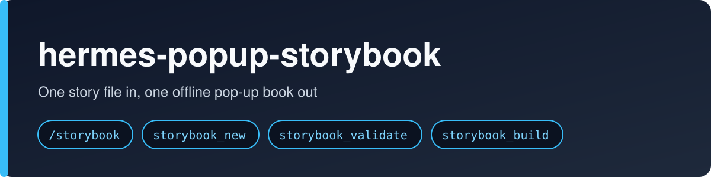
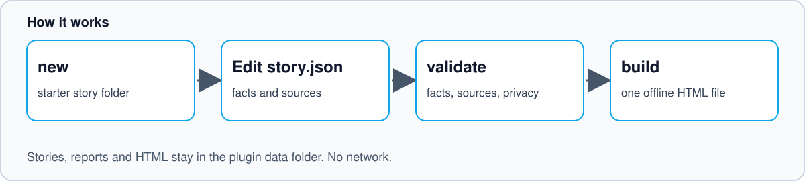

# hermes-popup-storybook



Make a virtual pop-up book from a real history. You write one story file. The engine builds one HTML file that works offline, on a desk or a phone, and prints as a flat edition.

It is made for keepsakes: a project's story before a shutdown, a team's year, a handover. Every fact in the book points to its source.

## Goals

- **Safe intake.** A new story folder states what can be read, what must be skipped, and what stays in private storage.
- **Flow-first pages.** Every written page names its start, hand-driven action, result, trial, and lesson before layout begins.
- **Grounded copy.** Authors get a clear check for numbers and dates in main text, trial text, and lesson text.
- **Measured accessibility.** Layout QA checks WCAG AA contrast for reader-facing text and fails when it checks nothing.
- **Readable paper motion.** Effect windows that swap nearby pieces are staggered. No time-based autoplay is used.
- **Comfortable optional sound.** Repeated paper sounds stay warm, quiet, and bounded in frequency.
- **Shareable private preview.** Screenshot tools can save one settled, full-spread cover card alongside normal QA shots.
- **One operating path.** The scaffold work order, docs, and tests describe the same commands and checks.

## Non-goals

- Do not turn books into MP4 launch videos or time-based autoplay animations.
- Do not add FFmpeg, npm packages, external audio files, sampled sound effects, or voiceover.
- Do not make a hosted publishing service or hosted intake form.
- Do not change the core paper controls, page-turn rules, story JSON runtime shape, pixel-art style, or private-by-default policy.
- Do not use OCR, language models, or network calls for claim checking.
- Do not promise complete semantic fact checking. The fixed-rule check covers numeric and date-like claims only.
- Do not make a passing contrast check proof that all accessibility requirements are met.
- Do not make preview images public. They stay in the selected output folder.

## What a book has

Each entry is a spread. The left page holds the text, a pull tab and a fact booklet. The right page is a tunnel-book pop-up: a back wall, a floor in perspective, and pixel-art cut-outs that fold flat and stand up as the page turns.

The controls copy real paper mechanisms. Nothing plays a canned animation. The picture follows your hand.

- **Pull tab.** A slider in a slot on the text page. Pull it towards the picture and the scene moves as you pull. It stops when you stop and runs back when you push. A strip moves with the tab and shows "the trial" through a window above the slot.
- **Lift flap.** A paper flap hinged along the top of the picture. Lift it, by click or drag, and "what I learned" is printed underneath. The scene settles into its final pose. Let go too early and it falls shut.
- **Fact booklet.** A small booklet taped to the corner of the text page, with the number of facts on its cover. It opens in place, one fact and its source per spread, and its pages turn.
- **Paper wheel.** A numbers spread with a wheel you turn to see each month.
- **Storyboard mode.** The same file shows a planning sheet when opened with `#storyboard`.
- **Print edition.** Printing gives one flat landscape page per entry, in its final state.
- **Paper sounds.** Optional, off by default, made in the browser.

## Quick start

You need Python 3.10 or later. The engine has no other dependencies.

Start your own book with the scaffold:

```bash
python3 tools/new_story.py my-book --title "My book"
python3 engine/validate.py stories/my-book/story.json --strict
python3 engine/build.py stories/my-book/story.json -o dist/my-book/index.html
```

The scaffold includes the planning files and one complete fictional page. Its pull tab, lesson flap, facts, sources, contents, numbers and back page all work.

Open `dist/my-book/index.html` in a browser. Arrow keys turn pages. On a phone, swipe the stage. Add `#storyboard` to the address to see the planning sheet.

Use `stories/example/story.json` as a larger reference after the starter page makes sense.

## Hermes plugin



### Install

```bash
hermes plugins install j78f88/hermes-popup-storybook
hermes plugins enable hermes-popup-storybook
```

Start a new Hermes session and run `/storybook help`. To check a local checkout first, run
`hermes plugins validate .` and `hermes plugins doctor --ci .` from its root.

The plugin provides `storybook_new`, `storybook_validate` and `storybook_build`,
plus `/storybook`. It has no runtime dependencies, credentials or network calls.
Python wheel installs also expose the `hermes_agent.plugins` entry point.
See the official [plugin guide](https://hermes-agent.nousresearch.com/docs/developer-guide/plugins).

```text
/storybook new my-book "My book"
/storybook validate my-book
/storybook build my-book
```

### Slash command help

`/storybook`, `/storybook help`, `-h`, `--help` and `?` print this text. A test keeps this copy in step with the code.

```text
/storybook - build an offline pop-up storybook from one story file

Usage:
  /storybook new <name> ["Title"]         Create a starter story folder
  /storybook validate <name> [--strict]   Check the story and write a report
  /storybook build <name> [--strict]      Validate, then write one offline HTML file
  /storybook help                         Show this message

<name> is a lowercase slug, not a path. Validation is always strict.

Examples:
  /storybook new my-book "My book"
  /storybook validate my-book
  /storybook build my-book

Notes:
  Stories, reports and HTML stay in the plugin data folder. No network, no credentials.
  Edit the story file that "new" prints, then validate and build again.
  The same steps are available to the agent as storybook_new, storybook_validate
  and storybook_build.
```

In `/help`, Hermes lists the command as `/storybook new|validate|build <name> | help`.

### Troubleshooting

| You see | Cause and fix |
|---|---|
| `name must be 1-64 lowercase letters, numbers or hyphens` | Use a slug such as `my-book`, not a path or a title. |
| `Story validation failed; nothing built` | Run `/storybook validate <name>`. The report lists each error and warning. Fix the story file and build again. |
| `cannot run ... Run /storybook help for usage.` | The action or its arguments were not recognised. Check the usage above. |
| `/storybook` is not found | The plugin is installed but not enabled. Run `hermes plugins enable hermes-popup-storybook` and start a new session. |

### Details

Tool arguments use `name` (a lowercase slug, not a path). Creation accepts `title`
and `pages` (1-100, default 3); validation and build accept `strict` (default true).
All tool handlers return JSON strings, including failures, as
`{"ok": false, "tool": ..., "error": ..., "error_type": ...}`. The `/storybook`
command prints the same results as plain text and never raises. Edit the returned
story path to replace the fictional starter material, then validate and build again.

Plugin output is under `plugin_data_dir("hermes-popup-storybook")`, following the
active Hermes profile: `stories/<name>/`, `reports/<name>/validation.json` and
`dist/<name>/index.html`. It never falls back to writing into the install tree or
current directory. Creation refuses existing folders; builds replace only the
selected story's HTML after validation succeeds. Slug and resolved-path checks
reject traversal and symlink escapes. Open the returned HTML path locally; there
is no automatic publishing.

Optional CLI helpers remain separate: `_browser.py` starts the Python builder,
`build_and_check.py` starts validation/build/QA scripts, `release_check.py` invokes
Git, and Playwright launches browser processes. The unregistered `visual_qa.py`
CLI uploads screenshots and briefs to OpenRouter (or `OPENROUTER_URL`), reads
`OPENROUTER_API_KEY` through Hermes secret scope (the process environment only when
Hermes is not importable), and may incur charges. Neither the tools
nor `/storybook` call it. No credentials are stored. See `plugin.yaml` for the
subprocess disclosures and `SECURITY.md` for limits and private reporting.

## The process

Making a good book is mostly not code. `docs/PROCESS.md` is the method, in twelve steps:

1. Brief
2. Sources
3. Fact ledgers
4. Outline
5. Storyboard
6. Write
7. Lay out
8. Build
9. Measure
10. Look
11. Owner review
12. Publish

The owner signs off the brief and the storyboard before the full build. Steps 9 to 12 repeat as a loop until the owner is happy, and each round is a new edition.

## Docs

| File | What it covers |
|---|---|
| `docs/PROCESS.md` | The method, step by step |
| `docs/ADR.md` | Architecture decisions and non-goals |
| `docs/STORYBOARD.md` | Storyboard mode and owner reviews |
| `docs/AUTHORING.md` | The story file: fields, scenes, effects, composition tips |
| `docs/DESIGN-RULES.md` | The defaults, and why each one exists |
| `docs/TOOLS.md` | The QA and publishing tools |
| `docs/SPRITES.md` | Searchable sprite names, sizes and tags |
| `docs/sprites.png` | A visual sheet of every sprite |
| `docs/assets/` | The banner and flow diagram used in this README |
| `templates/` | Brief, sources, outline, storyboard, fact ledger, checklists and QA briefs |

## Tools

The QA tools drive a real browser, so they need Playwright and Pillow:

```bash
pip install playwright pillow
python3 -m playwright install chromium
```

| Tool | What it does |
|---|---|
| `tools/new_story.py` | Starts a complete working story folder |
| `tools/check_ledger.py` | Checks fact ledgers, story source IDs and prose claim numbers |
| `tools/list_sprites.py` | Lists sprite names, sizes and tags |
| `tools/check_layout.py` | Opens every page in every state and fails on layout or contrast bugs |
| `tools/check_mechanics.py` | Checks the paper mechanics rules on desktop and phone |
| `tools/shoot.py` | Saves four states, contact sheets and an optional cover card |
| `tools/visual_qa.py` | Sends screenshots to a vision model for an outside review |
| `tools/export_pdf.py` | Exports the print edition and the storyboard as PDF |
| `tools/release_check.py` | Scans tracked and untracked files before sharing |
| `tools/sprites_src.py`, `tools/font_src.py` | Rebuild the sprite and font library |

Use `release_check.py --baseline FILE` when a reviewed baseline applies.

## What the validator enforces

- Every written entry has text, a scene and at least 3 facts.
- Every fact cites a source that exists in `sources`, and every source has a `kind` and a `ref`.
- Every sprite, effect target and effect name exists.
- Nearby hide and show effects on the same control warn when their travel windows overlap.
- Entry numbers run 1, 2, 3 in order.
- No secrets or private network details. Keys, tokens, private keys, private IP addresses, private hostnames, emails and password assignments all fail the build.
- `--deny FILE` adds your own banned terms, one per line. Use it for customer names or private projects.

The builder runs the validator first and refuses to write a book that fails.

## Repo layout

```text
engine/      the builder, validator, renderer, styles and sprite library
stories/     one folder per book; this repo ships only the example
templates/   planning and review templates copied into new stories
tools/       scaffold, QA, export and release tools
docs/        process, authoring and design rules
tests/       unit and browser tests
```

Keep real books in their own repos. A book carries private history, and the engine should be shareable without it.

## Tests

For the fast tier (no browser launches), install the dev extra and run:

```bash
python3 -m pip install '.[dev]'
python3 -m pytest -m "not browser"
```

Run the browser tier separately with `python3 -m pytest -m browser` after installing
`.[dev,qa]` and Playwright browsers. Plain unittest discovery still runs the `unittest` suites.
It does not run `tests/test_plugin.py`, which needs pytest:

```bash
python3 -m unittest discover -s tests
python3 -m pytest -q tests/test_plugin.py
```

Node is used to syntax-check and smoke-run the page script. Browser tests are skipped when Playwright is not installed.

## Privacy

Books are private by default. The validator stops obvious leaks, but it can't judge context. Read the fact cards before you share a book with anyone.

## Licence

Released under the MIT licence. See `LICENSE`.
